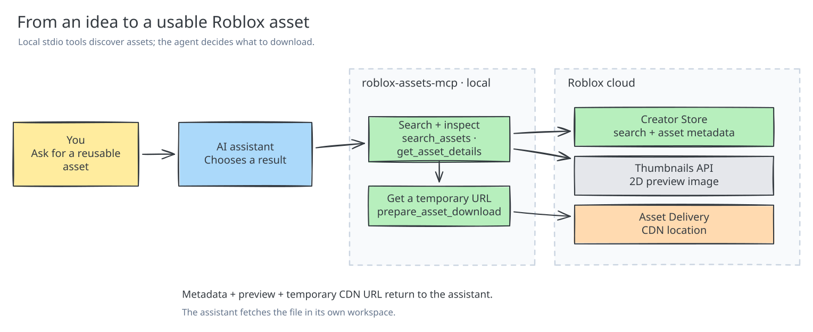

<h1 align="center">🧱 roblox-assets-mcp</h1>

<br>

<h3 align="center">An MCP server for finding Roblox Creator Store assets.<br>Give an assistant a way to search, inspect, and retrieve what a game needs.</h3>

<p align="center">
  <a href="https://pypi.org/project/roblox-assets-mcp/"></a> <a href="https://github.com/Petri-Hub/roblox-assets-mcp/actions/workflows/quality.yml"></a>  <a href="LICENSE.md"></a> 
</p>

<br>

## About

> **TL;DR:** a local, asset-only MCP server for Roblox Creator Store. An assistant can search reusable assets, inspect their metadata and 2D thumbnails, and request a temporary download URL. It leaves downloading and working with the asset to the assistant's own environment.

## Why it exists

[I am building a Roblox game with friends and an AI agent](https://github.com/Petri-Hub/roblox-with-swe). The agent can help with code, but it also needs the same raw material a human creator would look for: models, audio, decals, plugins, and other things already made for Roblox. This server gives it a small set of tools for that part of the work.

For example, I can ask the agent to find a free forest cabin, check who made it and whether it contains scripts, inspect its preview, and get a URL for the asset it chooses. The agent can then fetch and examine the file in its own workspace before using it in a project.

## How it works

<p align="center">
  
</p>

The assistant calls three tools over local stdio. The server sends HTTPS requests to Roblox with [HTTPX](https://www.python-httpx.org/), using an Open Cloud API key for Creator Store and Asset Delivery. It reads 2D previews from the public Thumbnails API. The API key stays in the server process and is never part of a tool response.

## What it can do

| Tool | What it returns |
|---|---|
| `search_assets` | Matching Creator Store assets, including names, creators, prices when available, and a token for the next page |
| `get_asset_details` | One asset's metadata and the state and URL of its 2D PNG thumbnail when ready |
| `prepare_asset_download` | A temporary HTTPS CDN URL for one asset; the tool does not save the file |

Search covers `Audio`, `Place`, `Model`, `Decal`, `Plugin`, `MeshPart`, `Video`, and `FontFamily`. It starts with free `Model` assets unless the assistant chooses another category or sets `free_only=false`. A returned `next_page_token` can be passed back as `page_token` to keep searching. Roblox may still be preparing a thumbnail, in which case the response contains its state without a thumbnail URL.

The download URL expires, so the assistant should fetch it promptly. Asset Delivery may return a compressed asset; the environment downloading it needs to handle that format. This server does not install an asset into Studio, manage an inventory, or change anything in Roblox.

## Installation

Roblox Assets MCP is published on [PyPI](https://pypi.org/project/roblox-assets-mcp/) as a local **stdio** server. With [`uv`](https://docs.astral.sh/uv/getting-started/installation/) installed, an MCP client can run it through `uvx roblox-assets-mcp`. The package requires Python 3.12 or newer; `uvx` can obtain a compatible Python if needed.

### What you will need

Create a Roblox [Open Cloud API key](https://create.roblox.com/docs/cloud/open-cloud/api-keys) with these scopes:

| Scope | Used for |
|---|---|
| `creator-store-product:read` | Searching Creator Store and reading asset details |
| `legacy-asset:manage` | Asking Asset Delivery for an asset's download location |

If you enable IP restrictions, allow the address of the machine running the MCP server. The public 2D thumbnail endpoint needs no additional scope. Keep the key in your MCP client's environment configuration, never in a project file that you commit. A key used only for testing can be revoked afterward.

The server checks both authenticated Roblox services before opening its MCP connection. A missing or blank `ROBLOX_API_KEY`, invalid key, missing scope, or unusable access check stops startup with an error. If Roblox rejects a later call or rate limits it, the tool reports that failure explicitly.

### Client-specific instructions

Each example below launches the same package. Replace `YOUR_ROBLOX_OPEN_CLOUD_API_KEY` with your key in a private user configuration, or use your client's secret or environment-variable support where available. If `uvx` is not on the client's `PATH`, use its absolute path as the command.

<details>
<summary>Hermes Agent (Pepper)</summary>

Add a server to your Hermes profile's `mcp_servers` configuration. Pepper's existing profiles use this `uvx` pattern:

```yaml
mcp_servers:
  roblox-assets:
    command: uvx
    args: [roblox-assets-mcp]
    env:
      ROBLOX_API_KEY: "${ROBLOX_API_KEY}"
```

Set `ROBLOX_API_KEY` in the environment that starts Hermes. See [Pepper's configuration](https://github.com/Petri-Hub/pepper) for the wider setup.

</details>

<details>
<summary>Claude Code</summary>

Run this in a terminal. The `user` scope makes the server available across projects:

```sh
claude mcp add --transport stdio --scope user \
  --env "ROBLOX_API_KEY=YOUR_ROBLOX_OPEN_CLOUD_API_KEY" \
  roblox-assets -- uvx roblox-assets-mcp
```

Check the connection with `claude mcp get roblox-assets` or `/mcp` inside Claude Code. See the [Claude Code MCP guide](https://code.claude.com/docs/en/mcp).

</details>

<details>
<summary>Claude Desktop</summary>

Open **Settings → Developer → Edit Config** and add this entry inside `mcpServers`:

```json
{
  "mcpServers": {
    "roblox-assets": {
      "command": "uvx",
      "args": ["roblox-assets-mcp"],
      "env": {
        "ROBLOX_API_KEY": "YOUR_ROBLOX_OPEN_CLOUD_API_KEY"
      }
    }
  }
}
```

Restart Claude Desktop after saving. See [Claude Desktop local MCP setup](https://support.claude.com/en/articles/10949351-getting-started-with-local-mcp-servers-on-claude-desktop).

</details>

<details>
<summary>OpenAI Codex</summary>

Add this to `~/.codex/config.toml`. The same user config is used by Codex CLI and its IDE integrations:

```toml
[mcp_servers.roblox-assets]
command = "uvx"
args = ["roblox-assets-mcp"]
env = { ROBLOX_API_KEY = "YOUR_ROBLOX_OPEN_CLOUD_API_KEY" }
```

Restart Codex, then check the server with `codex mcp list`. See the [Codex configuration reference](https://developers.openai.com/codex/config-reference/).

</details>

<details>
<summary>OpenCode</summary>

Add this server under `mcp` in your user `~/.config/opencode/opencode.json` or project `opencode.json`:

```json
{
  "mcp": {
    "roblox-assets": {
      "type": "local",
      "command": ["uvx", "roblox-assets-mcp"],
      "environment": {
        "ROBLOX_API_KEY": "YOUR_ROBLOX_OPEN_CLOUD_API_KEY"
      },
      "enabled": true
    }
  }
}
```

See the [OpenCode MCP server guide](https://opencode.ai/docs/mcp-servers/).

</details>

<details>
<summary>Gemini CLI</summary>

Run:

```sh
gemini mcp add --scope user \
  --env "ROBLOX_API_KEY=YOUR_ROBLOX_OPEN_CLOUD_API_KEY" \
  roblox-assets uvx roblox-assets-mcp
```

Check with `gemini mcp list`. See the [Gemini CLI MCP guide](https://github.com/google-gemini/gemini-cli/blob/main/docs/tools/mcp-server.md).

</details>

<details>
<summary>Grok Build</summary>

Add this to `~/.grok/config.toml`:

```toml
[mcp_servers.roblox-assets]
command = "uvx"
args = ["roblox-assets-mcp"]
env = { ROBLOX_API_KEY = "YOUR_ROBLOX_OPEN_CLOUD_API_KEY" }
enabled = true
```

Reload the MCP list in Grok Build after saving. See the [Grok Build MCP guide](https://github.com/xai-org/grok-build/blob/main/crates/codegen/xai-grok-pager/docs/user-guide/07-mcp-servers.md).

</details>

<details>
<summary>DeepSeek Harness</summary>

Add this MCP client entry to your DeepSeek Harness Cordis profile. Start the harness with `ROBLOX_API_KEY` set in its environment:

```yaml
- id: mcp-roblox-assets
  name: '@deepseek-ai/dsh-mcp-client'
  config:
    serverName: roblox-assets
    transport: stdio
    command: uvx
    args: [roblox-assets-mcp]
    env:
      ROBLOX_API_KEY: !!js process.env.ROBLOX_API_KEY
```

See the [DeepSeek Harness MCP client guide](https://github.com/deepseek-ai/deepseek-harness/blob/master/packages/mcp/mcp-client/README.md).

</details>

<details>
<summary>Cursor</summary>

Add this entry under `mcpServers` in `.cursor/mcp.json`:

```json
{
  "mcpServers": {
    "roblox-assets": {
      "command": "uvx",
      "args": ["roblox-assets-mcp"],
      "env": {
        "ROBLOX_API_KEY": "YOUR_ROBLOX_OPEN_CLOUD_API_KEY"
      }
    }
  }
}
```

See the [Cursor MCP guide](https://cursor.com/docs/context/mcp).

</details>

<details>
<summary>VS Code with GitHub Copilot</summary>

Create or edit `.vscode/mcp.json`:

```json
{
  "servers": {
    "roblox-assets": {
      "type": "stdio",
      "command": "uvx",
      "args": ["roblox-assets-mcp"],
      "env": {
        "ROBLOX_API_KEY": "YOUR_ROBLOX_OPEN_CLOUD_API_KEY"
      }
    }
  }
}
```

Start the server from the MCP Servers view in Copilot Chat. See [VS Code MCP setup](https://code.visualstudio.com/docs/agent-customization/mcp-servers).

</details>

<details>
<summary>Zed</summary>

Add this entry under `context_servers` in Zed's `settings.json`:

```json
{
  "context_servers": {
    "roblox-assets": {
      "command": "uvx",
      "args": ["roblox-assets-mcp"],
      "env": {
        "ROBLOX_API_KEY": "YOUR_ROBLOX_OPEN_CLOUD_API_KEY"
      }
    }
  }
}
```

See the [Zed MCP guide](https://zed.dev/docs/ai/mcp).

</details>

<details>
<summary>Cline and Roo Code</summary>

In either extension's MCP settings, add a **local stdio** server with command `uvx`, argument `roblox-assets-mcp`, and environment variable `ROBLOX_API_KEY`. Both provide an MCP settings editor in the extension UI. See the [Cline MCP guide](https://github.com/cline/cline/blob/main/docs/mcp/mcp-overview.mdx) and [Roo Code MCP guide](https://roocodeinc.github.io/Roo-Code/features/mcp/using-mcp-in-roo/).

</details>

<details>
<summary>Continue</summary>

Create `.continue/mcpServers/roblox-assets.yaml`:

```yaml
name: Roblox Assets MCP
version: 1.0.0
schema: v1
mcpServers:
  - name: Roblox Assets
    command: uvx
    args:
      - roblox-assets-mcp
    env:
      ROBLOX_API_KEY: YOUR_ROBLOX_OPEN_CLOUD_API_KEY
```

See the [Continue MCP guide](https://docs.continue.dev/customize/deep-dives/mcp).

</details>

<details>
<summary>Claude.ai and ChatGPT in a browser</summary>

These web apps connect to **remote** MCP servers. This package runs locally over stdio and does not publish a remote endpoint, so you cannot paste `uvx roblox-assets-mcp` into their connector settings. Connecting a web app requires a separately hosted or securely tunneled remote MCP endpoint. See [Claude remote connectors](https://support.claude.com/en/articles/11175166-get-started-with-custom-connectors-using-remote-mcp) and [ChatGPT MCP connectors](https://help.openai.com/en/articles/12584461-developer-mode-and-full-mcp-connectors-in-chatgpt).

</details>

### Local development and configuration

From this repository, `uv sync` installs the project and `uv run roblox-assets-mcp` launches it with `ROBLOX_API_KEY` set. It also reads a `.env` file from its working directory; the file is ignored by Git, and process environment variables take precedence. If your client starts the server elsewhere, its working directory determines which `.env` file is read.

The API URLs and request timeout are optional overrides. Their defaults are:

| Variable | Default |
|---|---|
| `CREATOR_STORE_URL` | `https://apis.roblox.com/toolbox-service/v2/assets` |
| `DELIVERY_URL` | `https://apis.roblox.com/asset-delivery-api/v1/assetId` |
| `THUMBNAILS_URL` | `https://thumbnails.roblox.com/v1/assets` |
| `REQUEST_TIMEOUT` | `20.0` seconds |

## Philosophy

**Only the asset workflow.**<br>
The three tools follow the path from a search to an inspected asset to a URL that the agent can fetch. Universe and place management belong to a different set of tools.

**Let the assistant choose.**<br>
Search returns structured names, creators, prices and IDs. Details add a preview and script flag when Roblox provides them. The agent has enough information to compare candidates before downloading one.

**Keep the key local.**<br>
Roblox authentication happens in the MCP process. The agent sees asset data and temporary URLs, while the key remains in the process environment. Access is checked before the server announces itself to the client.

**Leave files with the caller.**<br>
The server obtains the CDN location; the assistant decides where to fetch, inspect and store the asset. This keeps filesystem access and game integration in the environment that already owns the project.

## What's inside

```text
.
├── .github/
│   └── workflows/
│       ├── quality.yml        # formatting, lint, tests and build checks
│       └── release.yml        # build and publish a GitHub Release to PyPI
│
├── assets/                  # editable Excalidraw flow and its SVG for this README
│
├── src/roblox_assets_mcp/
│   ├── app.py               # stdio server, tools and startup check
│   ├── client.py            # Roblox HTTP requests and response parsing
│   ├── config.py            # environment settings and their defaults
│   └── models.py            # typed tool responses and asset categories
│
├── tests/                   # behavior checks for the server
├── Makefile                 # local quality commands
└── pyproject.toml           # package metadata and dependencies
```

## Technologies

| &nbsp;&nbsp;&nbsp;&nbsp;&nbsp; | Technology | Used for |
|:---:|---|---|
|  | [Model Context Protocol](https://modelcontextprotocol.io) | The protocol between the assistant and the local tools |
|  | [FastMCP](https://gofastmcp.com) | Stdio server and typed tool registration |
|  | [Python](https://docs.python.org/3/) | The language of the server |
|  | [HTTPX](https://www.python-httpx.org) | Async HTTPS requests to Roblox |
|  | [Pydantic](https://docs.pydantic.dev/) | Models for the data returned by tools |
|  | [uv](https://docs.astral.sh/uv/) | Dependencies, development and `uvx` distribution |

## Development

### Requirements

- [Git](https://git-scm.com/install/) to work with the repository.
- [uv](https://docs.astral.sh/uv/getting-started/installation/) to install Python and project dependencies.
- [GNU Make](https://www.gnu.org/software/make/) to run the project commands.

### Setup

From the repository root:

```bash
# Install the dependencies pinned in uv.lock.
uv sync --locked --group dev
```

### Coding

```bash
# Format the Python files after editing them.
make format-apply

# Check formatting and lint separately when needed.
make format-check
make lint
```

### Testing and building

```bash
# Run the server tests.
make test

# Build the source distribution and wheel in dist/.
make build

# Run formatting, lint, tests and build together.
make quality
```

The [quality workflow](.github/workflows/quality.yml) runs the same checks for pull requests and pushes to `main`.

## Release

With the release changes ready on `main` and the [GitHub CLI](https://cli.github.com/) authenticated, bump the package version and publish a GitHub Release:

```bash
# Update pyproject.toml and uv.lock to the next patch version.
uv version --bump patch

# Check the version that will be published.
make quality

# Commit and push the version change.
git add pyproject.toml uv.lock
git commit -m "chore(release): bump package version"
git push origin main

# Publish a GitHub Release with a tag matching the package version.
gh release create "v$(uv version --short)" --generate-notes
```

Use `--bump minor` or `--bump major` when the change calls for it. The [release workflow](.github/workflows/release.yml) checks the tag, builds the package and publishes it to PyPI through GitHub OIDC and the `PyPI - Production` environment. The PyPI page receives README changes with a new package version.

## Related projects

- [roblox-with-swe](https://github.com/Petri-Hub/roblox-with-swe) is the collaborative Roblox game that motivated this server.
- [pepper](https://github.com/Petri-Hub/pepper) documents the personal agent that will use it.

## Disclaimer

This project is unofficial. It is not made by, affiliated with or endorsed by Roblox.

## License

This repository is licensed under the [MIT License](LICENSE.md).

## References

- [Roblox Creator Store API](https://create.roblox.com/docs/cloud/reference/features/creator-store): search and asset metadata.
- [Roblox Asset Delivery API](https://create.roblox.com/docs/cloud/reference/features/assets): temporary asset download locations.
- [Roblox Thumbnails API](https://create.roblox.com/docs/cloud/reference/features/thumbnails): 2D previews.
- [Roblox Open Cloud scopes](https://create.roblox.com/docs/cloud/reference/scopes): the permissions used by the API key.
- [Model Context Protocol](https://modelcontextprotocol.io): the tool protocol this server speaks.
